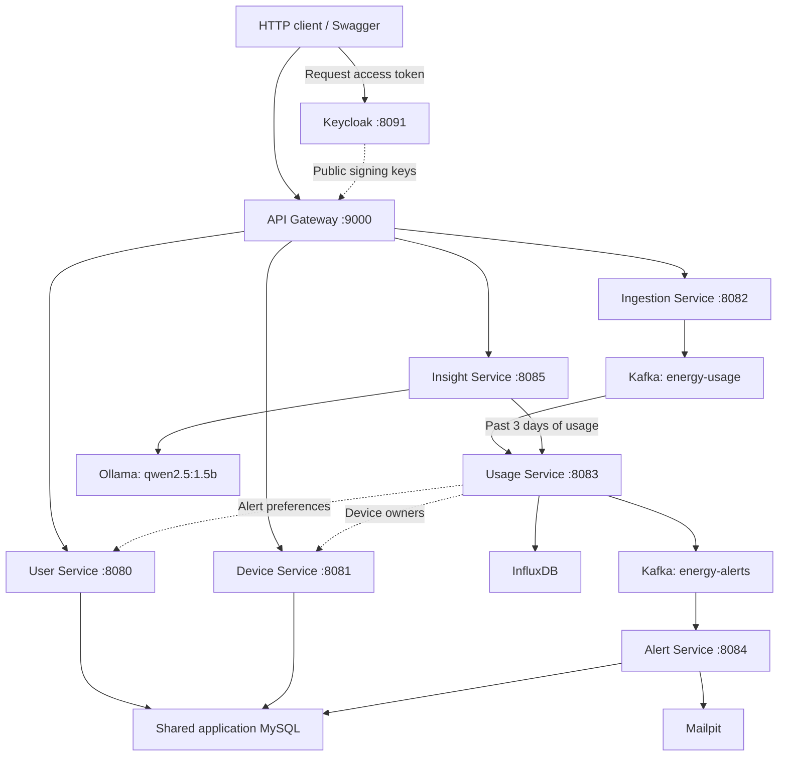

# Home Energy Tracker

A Spring Boot microservices application that collects household device readings, stores time-series usage, sends threshold alerts, and generates energy-saving insights with a local AI model. Seven independently run applications communicate through HTTP and Kafka, with Keycloak authentication at the API Gateway and Prometheus/Grafana monitoring.

**Local development setup:** Docker Compose runs the infrastructure, the seven Java applications run on your host, and Ollama runs separately on your host. A fresh clone has no sample users/devices or preconfigured Keycloak realm. Follow the setup below before sending authenticated requests.

## Contents

- [Architecture](#architecture)
- [Prerequisites](#prerequisites)
- [Local setup](#local-setup)
- [First end-to-end walkthrough](#first-end-to-end-walkthrough)
- [API reference](#api-reference)
- [Configuration and persistence](#configuration-and-persistence)
- [Monitoring and verification](#monitoring-and-verification)
- [Troubleshooting](#troubleshooting)
- [Current limitations](#current-limitations)
- [Stopping and restarting](#stopping-and-restarting)

## Architecture



The two Kafka topic boxes belong to the same local broker. Solid arrows show the main request/data flows; dotted arrows show supporting lookups.

| Application / folder | Port | Responsibility |
| --- | --- | --- |
| `User Service` | `8080` | User CRUD, alert preferences, all application Flyway migrations |
| `Device Service` | `8081` | Device CRUD and ownership lookup |
| `Ingestion Service` | `8082` | Accept readings, publish `EnergyUsageEvent`, run the simulator |
| `Usage Service` | `8083` | Consume readings, store/query InfluxDB, publish threshold alerts |
| `Alert Service` | `8084` | Consume alerts, send email to Mailpit, save delivery results |
| `Insight Service` | `8085` | Fetch usage and generate local AI advice |
| `API Gateway` | `9000` | Authenticated routing, circuit breakers, combined Swagger UI |

Usage checks the past **hour** every **10 seconds** for users with alerting enabled. Insight requests the past **3 days** of usage. User, Device, and Alert share one application MySQL database; Keycloak has a separate database. Service-to-service HTTP calls use the direct service ports. Usage and Alert have no public API routes in the gateway.

**Stack:** Java 21, Spring Boot 4.1.1, Spring Cloud 2025.1.3, Spring AI 2.0.1, springdoc 3.0.2, Kafka, MySQL, InfluxDB, Keycloak, Mailpit, Ollama, Prometheus, and Grafana. Each application has its own Maven wrapper; there is no root Maven aggregator.

## Prerequisites

- Git and access to this repository.
- **JDK 21**, selected for both the terminal and IDE. Check `java -version`; a JRE alone is insufficient.
- Docker Desktop, or Docker Engine with the **Compose v2** plugin. Check `docker compose version` and ensure the engine is running.
- [Ollama](https://ollama.com/download) for local AI insights. No cloud AI API key is required for the configured local model.
- IntelliJ IDEA with HTTP-client support for the request examples, or an HTTP client that can send the same requests. A separately installed Maven is unnecessary.
- Available ports from the application and infrastructure tables below. Other local projects must not occupy them.

Commands below use a macOS/Linux shell. In Windows terminals, adapt directory commands and use `mvnw.cmd` instead of `./mvnw`. This project was developed on macOS; these instructions do not claim a fresh-install verification on every operating system. Allocate Docker enough memory and disk for several infrastructure containers, and leave capacity for seven JVMs and the local model.

## Local setup

### 1. Clone and start infrastructure

```sh
git clone https://github.com/y0ussefmohamed/home-energy-tracker.git
cd home-energy-tracker
mkdir -p docker/keycloak/realms
docker compose config --quiet
docker compose up -d
docker compose ps
```

Run Compose commands from this repository root. The empty realm-import directory is intentional: private realm exports and database contents are excluded from Git. Docker starting successfully does not create the application realm/client or prove that every component is ready.

| Component | Host address | Local development configuration |
| --- | --- | --- |
| Application MySQL | `localhost:3306` | Database `home_energy_tracker`; `root` / `password` |
| Kafka | Host applications: `localhost:9094`; Docker clients: `kafka:9092` | Single-node KRaft; no ZooKeeper |
| Kafka UI | [localhost:8070](http://localhost:8070) | Cluster `local` |
| InfluxDB | [localhost:8072](http://localhost:8072) | `admin` / `password`; org `projects`; bucket `usage-bucket`; token `my-token` |
| Mailpit | [localhost:8025](http://localhost:8025) | SMTP `localhost:1025`; no SMTP authentication |
| Keycloak | [localhost:8091](http://localhost:8091) | Admin `admin` / `admin` |
| Keycloak MySQL | Docker-only `keycloak-db:3306` | Database `keycloak`; `keycloak` / `password` |
| Prometheus | [localhost:9090](http://localhost:9090) | Metrics retention: 5 days |
| Grafana | [localhost:3000](http://localhost:3000) | `admin` / `admin` on first initialization |
| Ollama | `http://localhost:11434` | Separate host process; see step 3 |

These defaults are for local development. Keep the environment on your development machine. Existing persistent volumes retain previous passwords and configuration; changing initialization variables does not automatically update an existing database.

Check startup logs if a component is still initializing or restarting:

```sh
docker compose logs --tail=100 mysql kafka influxdb keycloak-db keycloak
```

### 2. Configure Keycloak on a fresh checkout

Open [the Keycloak admin console](http://localhost:8091/admin/) and sign in with `admin` / `admin`.

1. Create a realm named **`het-security-realm`** and select it. Keep the realm enabled.
2. Under **Clients**, create an **OpenID Connect** client with ID **`home-energy-tracker-client`**.
3. Enable **Client authentication** and **Service accounts roles**. This makes it a confidential client supporting the client-credentials grant.
4. For this server-to-server walkthrough, disable **Standard flow** and **Direct access grants**. Browser redirect URIs and a human login account are unnecessary for this grant. Save the client.
5. Open the client's **Credentials** tab and copy its generated client secret into your local private HTTP-client environment, as shown in the walkthrough. Do not put the secret in this README or a committed request file.

If the realm/client already exists, reuse it and its current credentials. No additional application roles are required by the current gateway's authenticated-only policy.

Verify the realm's discovery endpoint responds:

```sh
curl --fail http://localhost:8091/realms/het-security-realm/.well-known/openid-configuration
```

The configured issuer is `http://localhost:8091/realms/het-security-realm`; public keys are at `/realms/het-security-realm/protocol/openid-connect/certs`. The client-credentials token authenticates the application. Creating a user through User Service creates a database profile; it does not create a Keycloak login or associate that profile with this token.

Keycloak persists its configuration in its separate MySQL database. Compose's `--import-realm` can import a local realm file on first creation, but no private export is supplied by this repository, and startup import skips an existing realm. See [Keycloak's service-account documentation](https://github.com/keycloak/keycloak/blob/24.0.1/docs/documentation/server_admin/topics/clients/oidc/service-accounts.adoc).

### 3. Prepare Ollama

Start the Ollama desktop application, or run the following in a separate terminal **if an Ollama server is not already running**:

```sh
ollama serve
```

Then download the model and check the local server:

```sh
ollama pull qwen2.5:1.5b
ollama list
curl --fail http://localhost:11434/api/tags
```

Confirm `qwen2.5:1.5b` appears in the installed models. Insight disables automatic model pulling, so starting the Java service will not download a missing model. See the [Ollama CLI reference](https://docs.ollama.com/cli).

### 4. Build and run the Java applications

In IntelliJ, open the repository, add each service's `pom.xml` as a Maven project if it is not discovered, select JDK 21, and reload Maven. Run each service's `*Application` main class separately.

For command-line use, open a separate terminal per application. From the repository root, for example:

```sh
cd "User Service"
./mvnw -Dmaven.test.skip=true package
./mvnw -Dmaven.test.skip=true spring-boot:run
```

Repeat with the appropriate folder. Folder names contain spaces and must be quoted. Packaging is optional when using `spring-boot:run`; the command above also demonstrates how to build a JAR. `-Dmaven.test.skip=true` skips test compilation and execution. Existing sample-data methods remain disabled and are not a setup prerequisite.

Start applications in this order, waiting for their startup logs before continuing:

1. **User Service**: wait for Flyway to apply `V1`–`V3`, creating `users`, `devices`, and `alerts`.
2. **Device Service**.
3. **Alert Service**, then **Usage Service**.
4. **Insight Service**, then **API Gateway**.
5. **Ingestion Service**, initially with the simulator disabled as described below.

Only User Service owns Flyway migrations. MySQL's initialization script creates/selects the database; it does not populate users or devices. If using MySQL Workbench, connect to `localhost:3306` with `root` / `password` and refresh `home_energy_tracker` after User Service starts.

**Use a quiet first run.** Ingestion normally generates **10,000 readings per minute**, with random device IDs **1–199**. On a fresh database those devices do not exist. Start it from a new terminal at the repository root with:

```sh
cd "Ingestion Service"
./mvnw -Dmaven.test.skip=true spring-boot:run -Dspring-boot.run.arguments='--simulation.requests-per-interval=0'
```

In IntelliJ, set `--simulation.requests-per-interval=0` in the Ingestion run configuration's **Program arguments**. This keeps manual ingestion available and avoids automatic traffic. Keep it set throughout the walkthrough. The other services use their checked-in properties.

## First end-to-end walkthrough

Run the requests below **one at a time, in order**, using IntelliJ's HTTP client. Copy the `http` blocks into one local `.http` file in the repository root. Other HTTP clients can use the same URLs, bodies, and Bearer token; capture the returned IDs rather than assuming they are `1`.

### 1. Obtain an access token

Create a local `http-client.private.env.json` beside your request file, replacing the placeholder with your own generated Keycloak client secret:

```json
{
  "local": {
    "keycloakClientSecret": "PASTE_YOUR_OWN_CLIENT_SECRET"
  }
}
```

This filename is already ignored by Git. Select the **local** environment in the HTTP client. The response handler below saves the token for subsequent requests without hardcoding it into the request file.

```http
### Get a client-credentials token
POST http://localhost:8091/realms/het-security-realm/protocol/openid-connect/token
Content-Type: application/x-www-form-urlencoded

grant_type=client_credentials&client_id=home-energy-tracker-client&client_secret={{keycloakClientSecret}}

> 
```

Expected: **200**, with `access_token`, `token_type`, and `expires_in`. Obtain a new token when it expires. Keep token responses and request histories private. For HTTP-client variable details, see [JetBrains' documentation](https://www.jetbrains.com/help/idea/http-client-variables.html).

Open [Swagger UI](http://localhost:9000/swagger-ui.html), select a service definition, and use **Authorize** with the access token only; Swagger supplies the `Bearer` prefix. The token is the `access_token` value, not the entire JSON response. **Try it out** should target `http://localhost:9000`.

### 2. Create a user

```http
### Create a profile; leave alerting off for the first run
POST http://localhost:9000/api/v1/user
Authorization: Bearer {{accessToken}}
Content-Type: application/json

{
  "name": "Demo",
  "surname": "Reader",
  "email": "reader-{{$uuid}}@example.com",
  "address": "Example home",
  "alerting": false,
  "energyAlertingThreshold": 1000.0
}

> 
```

Expected: **201**, with the saved user and its generated `id`. The dynamic email avoids reusing the same address on another walkthrough run; an existing email returns **409**.

### 3. Create a device belonging to that user

```http
### Register a device with the returned user ID
POST http://localhost:9000/api/v1/device
Authorization: Bearer {{accessToken}}
Content-Type: application/json

{
  "name": "Desk light",
  "type": "LIGHT",
  "location": "Office",
  "userId": {{userId}}
}

> 
```

Expected: **201**, with the device's generated `id`. Supported types are `SPEAKER`, `CAMERA`, `THERMOSTAT`, `LIGHT`, `LOCK`, and `DOORBELL`. The database requires an existing owner through `devices.user_id`.

### 4. Submit a reading

```http
### Publish one current reading
POST http://localhost:9000/api/v1/ingestion
Authorization: Bearer {{accessToken}}
Content-Type: application/json

{
  "deviceId": {{deviceId}},
  "energyConsumed": 0.75,
  "timestamp": "{{$isoTimestamp}}"
}
```

Expected: **201**, with no body. `timestamp` is an ISO-8601 instant; IntelliJ inserts the current time. Use a current timestamp so the reading falls within the query windows. The project does not define a physical unit for `energyConsumed`; use consistent values for readings and thresholds.

Publication is asynchronous: this response does not confirm that Kafka storage, Usage consumption, or downstream processing has completed. In [Kafka UI](http://localhost:8070), inspect `energy-usage` and the `usage-service` consumer group. Allow time for consumption before the next request.

### 5. Retrieve the user's per-device usage

```http
### Usage is a direct internal-service endpoint, not a gateway route
GET http://localhost:8083/api/v1/usage/{{userId}}?days=3
```

Expected: **200**, containing `userId` and a `devices` array. Each device has `id`, `name`, `type`, `location`, and `energyConsumed`. After consumption, a new device with only the one reading above has a total of `0.75`. Additional readings with distinct timestamps contribute to that total. If it is still zero, inspect Usage logs and InfluxDB before assuming the pipeline has finished.

### 6. Request AI insights

```http
### Energy-saving advice
GET http://localhost:9000/api/v1/insight/saving-tips/{{userId}}
Authorization: Bearer {{accessToken}}

### Short usage overview
GET http://localhost:9000/api/v1/insight/overview/{{userId}}
Authorization: Bearer {{accessToken}}
```

Expected on successful generation: **200**, with `userId`, `tips`, and numeric `energyUsage`. The number is calculated in Java from all device totals over the past three days. AI text varies, and its accuracy is not guaranteed. The first model request may take longer while Ollama loads it; the gateway allows up to 60 seconds for Insight. Empty or output-limited model responses return **502** rather than incomplete advice.

### 7. Optionally demonstrate an alert

To intentionally enable alerting for the profile created above, send this complete update:

```http
### Enable alerts with a threshold below the sample reading
PUT http://localhost:9000/api/v1/user/{{userId}}
Authorization: Bearer {{accessToken}}
Content-Type: application/json

{
  "name": "Demo",
  "surname": "Reader",
  "email": "{{userEmail}}",
  "address": "Example home",
  "alerting": true,
  "energyAlertingThreshold": 0.5
}
```

Expected: **200**. If the `0.75` reading is still within the past hour, the next aggregation cycle can publish to `energy-alerts`. Open [Mailpit](http://localhost:8025) to see captured mail. Alert Service also inserts an `alerts` row with the SMTP delivery result in `sent`. Mailpit captures local messages; it does not deliver this example to an external inbox.

**Turn alerting back off after observing it** by repeating the full update with `"alerting": false`. There is no cooldown: while usage stays above the threshold, another alert can be published every 10 seconds. Already queued alerts may still be delivered after the update. Do not enable the bulk simulator until matching device IDs exist; this manual walkthrough needs only one device.

## API reference

User, Device, Ingestion, and Insight use the gateway base URL `http://localhost:9000` with a Bearer token. Paths below are relative to that base unless stated otherwise.

| Service | Method and path | Normal success |
| --- | --- | --- |
| User | `POST /api/v1/user` | `201`, saved user |
| User | `GET /api/v1/user/{userId}` | `200`, user |
| User | `PUT /api/v1/user/{userId}` | `200`, updated user |
| User | `DELETE /api/v1/user/{userId}` | `204`, no body |
| Device | `POST /api/v1/device` | `201`, saved device |
| Device | `GET /api/v1/device/{id}` | `200`, device |
| Device | `PUT /api/v1/device/{id}` | `200`, updated device |
| Device | `DELETE /api/v1/device/{id}` | `204`, no body |
| Device | `GET /api/v1/device/user/{userId}` | `200`, device list |
| Ingestion | `POST /api/v1/ingestion` | `201`, no body |
| Insight | `GET /api/v1/insight/saving-tips/{userId}` | `200`, insight |
| Insight | `GET /api/v1/insight/overview/{userId}` | `200`, insight |
| Usage, direct port `8083` | `GET /api/v1/usage/{userId}?days=3` | `200`, per-device usage |

Usage defaults to three days; send a positive `days` value. Alert has no REST controller. Missing User/Device resources return `404`; duplicate user emails return `409`. PUT updates expect the full request body rather than a partial patch. Deleting a user also deletes their devices through the SQL foreign key; it does not remove historical InfluxDB readings.

## Configuration and persistence

Application settings are in each service's `src/main/resources/application.properties`. Important integration values:

| Setting | Default / owner |
| --- | --- |
| `spring.datasource.url` | `jdbc:mysql://localhost:3306/home_energy_tracker` in User, Device, Alert |
| `spring.kafka.bootstrap-servers` | `localhost:9094` in Ingestion, Usage, Alert |
| `influx.url`, `influx.org`, `influx.bucket` | `http://localhost:8072`, `projects`, `usage-bucket` in Usage |
| `device.service.url`, `user.service.url` | Direct Device/User URLs on `8081` / `8080` in Usage |
| `usage.service.url` | `http://localhost:8083/api/v1/usage` in Insight |
| `spring.ai.ollama.base-url`, `spring.ai.ollama.chat.model` | `http://localhost:11434`, `qwen2.5:1.5b` in Insight |
| `simulation.requests-per-interval` | `10000` normally; override to `0` for manual use |
| `simulation.interval-ms`, `simulation.parallel-threads` | `60000`, `10` in Ingestion |

Changing a port requires updating its callers, gateway route, and Prometheus target as appropriate. Gateway destination URLs are currently written in its Java route classes. A root `.env` file is not automatically loaded into host-run Spring applications; use explicit Spring overrides or IntelliJ run settings when changing application properties.

| Data | Storage |
| --- | --- |
| Application MySQL | Named volume `db-data` |
| Kafka log | Bind mount `docker/kafka_data/` |
| InfluxDB | Bind mount `docker/influxdb_data/`; bucket retention `1w` |
| Keycloak MySQL | Bind mount `volume-data/mysql_keycloak_data/` |
| Prometheus / Grafana | Named volumes `prometheus-data` / `grafana-data` |
| Mailpit messages | No persistent storage configured; messages can disappear when its container is recreated |

Bind-mounted data, private realm exports, backups, and private HTTP-client environments are ignored by Git. A fresh clone recreates infrastructure, not your local data. Applied Flyway migrations must remain unchanged; schema changes belong in a new numbered migration. Keep existing sample-data methods disabled during normal setup.

## Monitoring and verification

With the applications running:

```sh
curl --fail http://localhost:8080/actuator/health
curl --fail http://localhost:9000/actuator/health
```

The normal healthy response includes `"status":"UP"`. Other services expose the same health path on their own ports. This confirms their reported health, not the complete business pipeline; use the manual walkthrough to observe the data flow.

- **Swagger:** [localhost:9000/swagger-ui.html](http://localhost:9000/swagger-ui.html). Four service definitions use the gateway. Usage also has direct documentation at [localhost:8083/swagger-ui.html](http://localhost:8083/swagger-ui.html).
- **Kafka:** [localhost:8070](http://localhost:8070). Inspect `energy-usage`, `energy-alerts`, and consumer groups `usage-service` / `alert-service`. Topics appear when created/requested by the applications; `energy-alerts` may not exist before alert traffic.
- **InfluxDB:** [localhost:8072](http://localhost:8072). Use org `projects`, bucket `usage-bucket`, measurement `energy_usage`, tag `deviceId`, and field `energyConsumed`.
- **Prometheus:** [localhost:9090/targets](http://localhost:9090/targets). Expect **eight UP targets** when all seven applications and Prometheus are running. Scrapes occur every 15 seconds; a stopped Java application is a DOWN target.
- **Grafana:** [localhost:3000](http://localhost:3000). Open **Dashboards → Home Energy Tracker → Home Energy Tracker - Overview**. Panels show request/status/error rates, JVM heap usage, reachability, and busy endpoints. Generate intentional traffic and allow at least two scrapes for rate graphs; unused error series can initially be empty.
- **Mailpit:** [localhost:8025](http://localhost:8025). Look for the alert from the optional walkthrough and compare it with the `alerts.sent` value in MySQL.

Prometheus reaches host-run applications through `host.docker.internal`; Grafana reaches Prometheus through `http://prometheus:9090`. Both are provisioned by Compose. Prometheus reachability and nonempty AI output alone are not proof of business correctness.

## Troubleshooting

| Symptom | What to check |
| --- | --- |
| Docker cannot connect, or `docker compose` is unavailable | Start Docker Desktop/the engine; verify Compose v2 and Docker's CLI integration. |
| Image download times out | Check connectivity and retry `docker compose pull` before `docker compose up -d`; a download failure does not by itself mean YAML is invalid. |
| A port is already occupied | Identify the existing application/container using the tables above. Avoid killing unrelated Java processes or changing only one side of an integration. |
| A container restarts or reports permission errors | Inspect its Compose logs, available resources, and bind-mount ownership/write access, especially on Linux. |
| User/Device/Alert cannot access MySQL, or tables are missing | Check MySQL readiness and saved credentials; start User first and inspect Flyway logs. |
| Token endpoint returns `404` / `invalid_client` | Verify the realm, exact client ID, client authentication, service accounts, and the generated secret from the selected realm. |
| Gateway returns `401` | Obtain a current access token and send `Authorization: Bearer <token>`; use the realm configured in the gateway. |
| Gateway returns a service-specific `503` fallback | Check that downstream application's startup logs, port, and dependencies; allow the circuit breaker time to recover after readiness is restored. |
| InfluxDB / usage totals remain zero | Check Usage logs, org/bucket/token, real device IDs, reading timestamps, Kafka consumption, and a positive `days` value. Query failures currently also return zeros. |
| A request shows an unresolved `{{variable}}` | Select the `local` HTTP-client environment and execute the earlier token/user/device requests successfully. |
| Insight fails or times out | Check Ollama on `11434`, the installed model, Usage availability, and Insight/Gateway logs. The initial model load can take longer. |
| Insight returns `502` for the output limit | The model stopped before completing its answer; the response is intentionally rejected. The current output budget is 512 tokens. |
| Many alerts or device lookup failures appear | Stop bulk simulation/restart Ingestion with the quiet override; use valid registered device IDs and disable alerting for profiles that should not receive repeated alerts. |
| Grafana shows DOWN targets or empty rate panels | Start the Java applications separately from Docker, allow scrapes, and send traffic. Docker does not start the JVMs. |

## Current limitations

- **Local security boundary:** authentication is enforced at the gateway. Direct downstream HTTP ports remain accessible, and per-user ownership authorization is not implemented. The custom JWT decoder uses the JWK URL; the issuer property alone does not establish additional issuer/audience validation in that bean.
- **Input handling:** comprehensive request validation is not implemented. Use valid owners, supported device types, current timestamps, and positive query windows.
- **Usage error handling:** InfluxDB query failures can produce successful HTTP responses with zero totals. Inspect logs before interpreting zeros as no consumption.
- **Alert repetition:** there is no deduplication/cooldown while a user remains above the hourly threshold. SMTP success records delivery to Mailpit, not delivery to an external inbox.
- **AI advice:** the small local model can generate unsuitable suggestions. Numeric totals come from Java; the truncation guard does not validate the meaning of the advice. Units and tariffs are not defined by the data model.
- **Simulation and local infrastructure:** the simulator assumes device IDs 1–199; it does not create them. Kafka runs as one broker with replication factor 1. Some Compose images use `latest`, so future pulls can change infrastructure versions.
- **Verification scope:** the documented build commands skip tests. Disabled population methods and generated context-load test classes do not establish full integration coverage.

See [AGENTS.md](AGENTS.md) for detailed service contracts, coding conventions, and operational guidance. The setup documented here targets local development; deployment to a shared environment requires addressing the limitations above.

## Stopping and restarting

Stop the Java applications through their own terminal (`Ctrl+C`) or IntelliJ run controls, then from the repository root:

```sh
docker compose down
```

Named volumes and bind-mounted database directories remain available. Avoid `docker compose down -v`, volume pruning, or deleting database folders unless you explicitly intend to discard that data. Ollama is managed separately. To resume, bring Compose up, check readiness, and restart the Java applications in the same order; keep the Ingestion quiet override for manual use.
